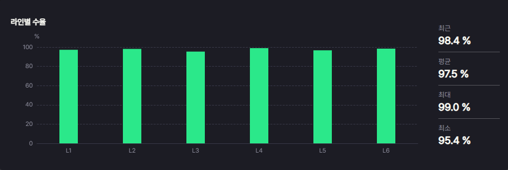
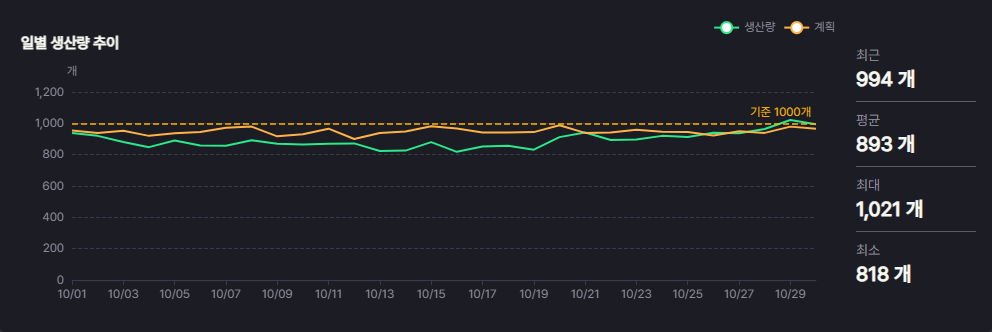
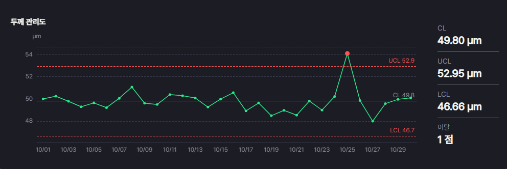
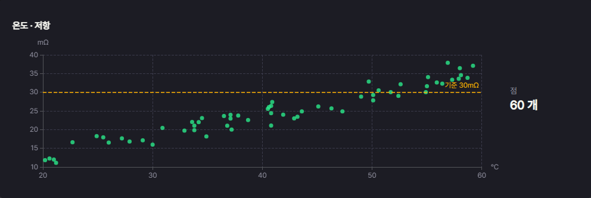
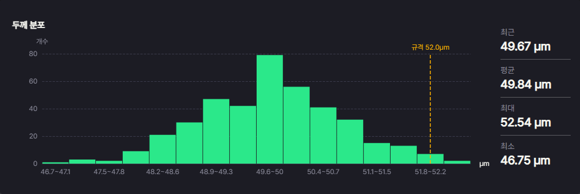
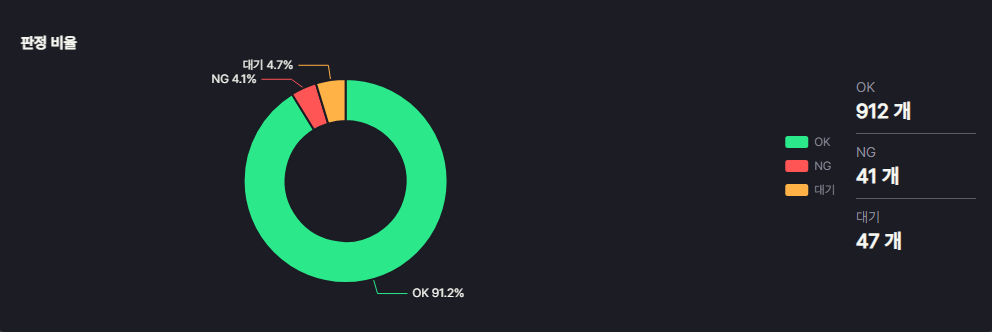
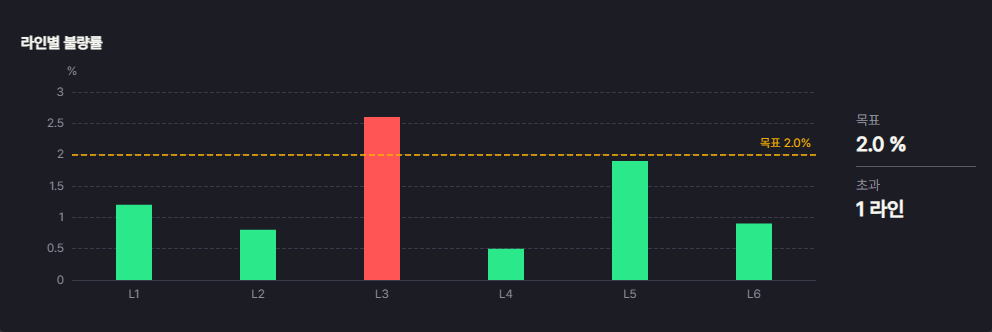
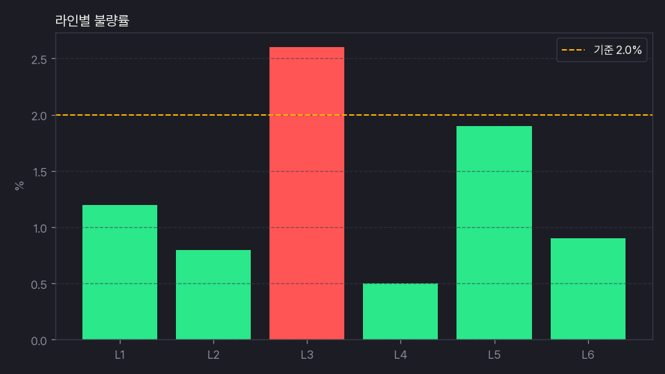
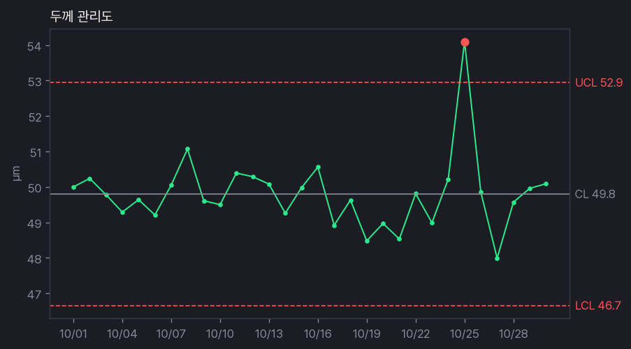

# 그래프 갤러리

- 코드: `ref/gallery/charts.py` — 필요한 함수만 `src/ui/` 로 복사해 씀(색은 `src/ui/theme.py` 토큰)
- 데모: `python3 ref/gallery/charts.py` → `http://<주소>:3000/` (`PORT` 로 바꿈)
- 시험: `python3 -m pytest ref/gallery -q`
- 규칙: 모든 그래프 함수는 `title` · `unit` · `ref_line` 을 키워드로 반드시 받는다 — 기준선이 없으면 `ref_line=None` 을 적는다(빠뜨리면 TypeError)
- 배치: 그래프 카드 `chart_card(옵션, 요약)` = 왼쪽 그래프 + 오른쪽 요약 숫자(`summary(값, 단위)` → 최근 · 평균 · 최대 · 최소)

| 그림 | 종류 | 함수 | 기준선 |
|---|---|---|---|
|  | 막대 | `bar_option(항목, 값, title, unit, ref_line)` | 선택 |
|  | 선(추이) | `line_option(x, {계열: 값}, title, unit, ref_line)` | 선택(첫 계열에) |
|  | 관리도(SPC) | `control_option(x, 값, title, unit, ref_line, limits=None)` · `control_limits(값)` | CL · UCL · LCL 자동(평균 ± 3σ) · 이탈 점 빨강 · ref_line = 규격선 |
|  | 산점도 | `scatter_option([(x, y)], title, unit, x_unit, ref_line)` | 선택(세로 값) |
|  | 히스토그램 | `hist_option(값, title, unit, ref_line, bins=10)` | 선택(규격 값 위치 세로선) |
|  | 파이 | `pie_option({항목: 값}, title, unit, ref_line=None)` | 없음(None 아니면 InputError) · OK · NG · 대기 는 상태 색 |
|  | 막대 + 목표선 | `bar_target_option(항목, 값, title, unit, ref_line)` | 필수 · 목표 초과 막대 빨강 |
|  | PNG 막대(matplotlib) | `png_bar(…, path)` | 선택 · 초과 막대 빨강 |
|  | PNG 관리도(matplotlib) | `png_control(…, path)` | 선택 |

- PNG 함수는 결과물(`out/`) 저장용 — 보고서 · 제출 그림
- 길이가 다른 목록을 넘기면 `InputError("… 길이 불일치 (a · b)")`
