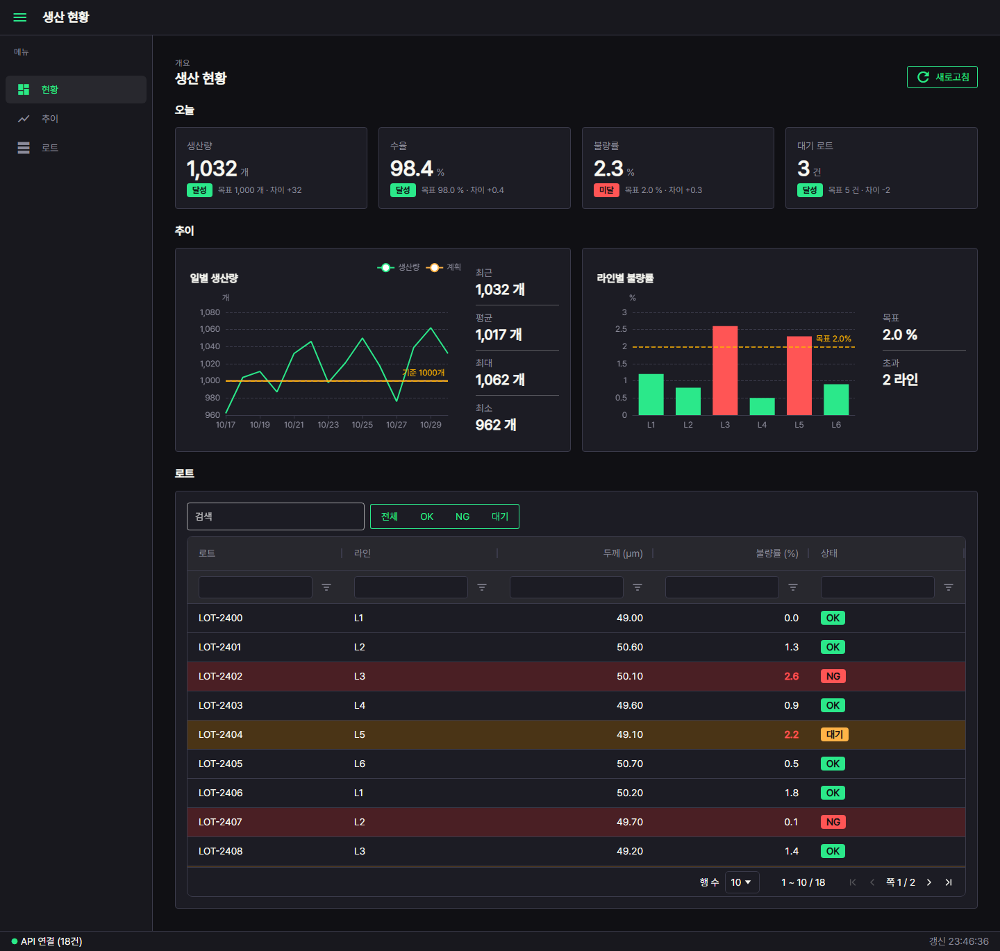
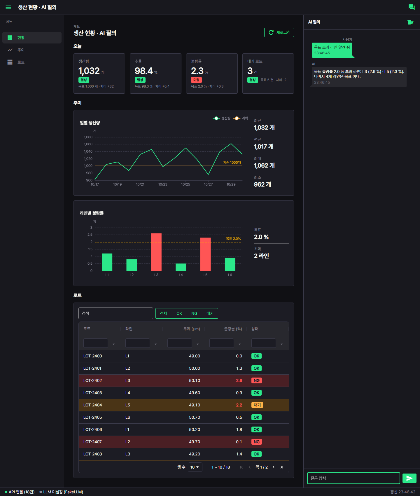

# 견본 앱 2개 — Tabler 세로 메뉴형 현황판 · 현황판 + 대화창

- 첫 화면을 고민하지 말고 둘 중 하나를 `src/ui/` 로 복사한 뒤 과제에 없는 패널을 지운다(UI_RULE 8절) — 🔴 견본은 ref.gallery · ref.table_form · lib.llm 을 import 한다 · 그 함수들도 src 로 복사하고 import 를 바꾼다(ref · lib 는 커밋되지 않아 새 환경에서 실패)
- 공통: 상단 바 · 왼쪽 세로 메뉴(접기) · 하단 상태바 연결 램프 · 빈 상태 «데이터 없음» · 오류 띠 «[종류] 메시지»
- 재사용: 색 `src/ui/theme.py` · 램프 `src/ui/app.py lamp()` · 그래프 `ref/gallery/charts.py` · 표 `ref/table_form.py` · LLM `lib/llm/llm_client.py`
- 시험: `python3 -m pytest ref/sample_apps -q`(서버 · 브라우저 없이 NiceGUI 사용자 흉내)

| 그림 | 앱 | 실행 |
|---|---|---|
|  | ① 현황판 `dashboard.py` — 숫자 카드(값 · 단위 · 목표 대비 배지) · 그래프 카드 2개(오른쪽 요약 숫자) · 로트 표(상태 배지) | `python3 -m ref.sample_apps.dashboard` |
|  | ② 현황판 + 대화창 `dashboard_chat.py` — ① 의 `build()` 를 그대로 부르고 오른쪽 drawer 에 말풍선 대화창(스트리밍 · 자동 스크롤 · 응답 중 입력 막기) | `python3 -m ref.sample_apps.dashboard_chat` |

- 둘 다 0.0.0.0 · 포트 `PORT` 환경변수(기본 3000) · 저장소 루트에서 실행
- 흉내 주소: `/?demo=empty` 빈 상태 · `/?demo=fail` 오류 띠 «[외부 실패] 현황 API 연결 실패 (…)» + API 램프 끊김

## 대회장에서 바꿀 곳(파일 안 «⭐ 바꿀 곳» 표시)

| 파일 | 이름 | 무엇 |
|---|---|---|
| dashboard.py | `APP_TITLE` | 앱 제목 |
| dashboard.py | `MENU` | 왼쪽 메뉴 (이름, 아이콘, 이동할 구역 id) |
| dashboard.py | `load_data()` | 가짜 데이터 → `src/api` 조회 결과로 같은 모양 dict 채움(실패는 `ExternalError` 로 올리면 오류 띠 · 램프가 따라옴) |
| dashboard.py | `table_columns()` | 표 열 — `text_col` · `number_col(target=목표)` · `status_col` |
| dashboard.py | `dashboard_body()` | 카드 · 그래프 종류(charts.py 함수 교체) |
| dashboard_chat.py | `APP_TITLE` · `FAKE_REPLIES` · `SYSTEM_PROMPT` | 제목 · 가짜 응답 · 시스템 지시(현황 숫자 문맥) |
| 환경변수 | `LLM_BASE_URL` · `LLM_API_KEY` · `LLM_MODEL` | 셋 다 있으면 실제 LLM(OpenAILLM), 없으면 FakeLLM · 램프 «LLM 미설정 (FakeLLM)» |

## 지울 패널 고르는 법

- 과제 요구에 숫자 · 그래프 · 표 중 없는 것 → `dashboard_body()` 에서 그 구역(`section_title` + 아래 블록)과 `MENU` 줄을 같이 지운다
- 메뉴가 2개 이하 → `shell()` 의 `ui.left_drawer` 블록과 상단 바 메뉴 단추를 지운다(가로 메뉴형)
- 표가 주인공 → 카드 · 그래프 구역을 지우고 `table_form(..., height_px=)` 을 키운다
- LLM 이 없는 과제 → ① 만 쓴다. LLM 이 핵심 → ② 에서 현황 구역을 줄이고 `CHAT_WIDTH_PX` 를 키운다
- 외부 연동이 없으면 램프 · 오류 띠도 지운다(쓰지 않는 부품은 과설계로 읽힌다)

## 참고 원본

- `ref/nicegui_examples/chat_app` · `todo_list` — NiceGUI 공식 예제 원본(MIT). 필요한 함수만 꺼내 씀
